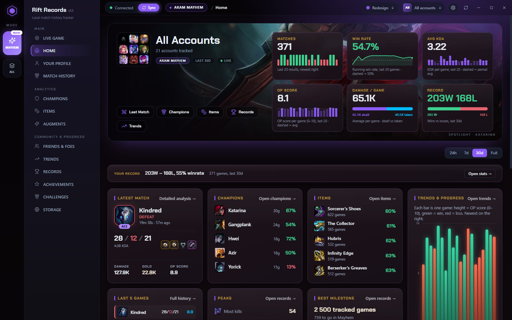
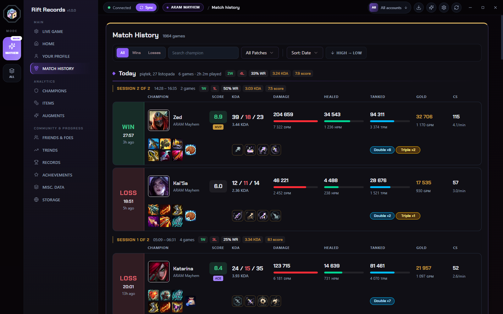

# Rift Records

A Windows desktop app that keeps your League of Legends match history on your own computer and turns it into dashboards: champions, items, augments, trends, records and live game data. ARAM Mayhem comes first, every other queue is tracked too.

**[Download the latest release](https://github.com/dxmegg/Rift-Records/releases/latest)** · [Changelog](CHANGELOG.md)

## Recent Changes

**1.0.0**

- **(NEW)** The numbering starts again: 1.0.0 brings together everything from the early builds
- **(NEW)** Diagnostics page in Settings: versions, connections, database and folders, with a report to copy or export
- **(NEW)** Log files in the program data folder, with tokens and player ids removed
- **(NEW)** What's new button in the top bar; the update window lists every release you missed
- **(IMPROVED)** Item statistics no longer freeze the window for about a second
- Various small fixes

Full history: [CHANGELOG.md](CHANGELOG.md) · [Early builds changelog](CHANGELOG-EARLY.md)

## Screenshots



|                                                  |                                            |
| ------------------------------------------------ | ------------------------------------------ |
|  |  |
|        |      |

## Features

- **Automatic tracking**: detects the League client and stores games as you play, also from the system tray
- **Live Game**: scoreboard, game flow charts, events and peak stats while a match is running
- **Match history**: grouped by day and session, with a detailed page per match (items, runes, augments, per-player stats)
- **Champions, Items, Augments**: win rates, KDA, damage, gold, multikills and detailed breakdowns
- **Match timeline**: gold and XP lead and a kill map for ARAM Mayhem games
- **Misc. Data**: what the other players in your games picked and built
- **Scoring**: separate systems for ARAM, Summoner's Rift and Arena, with MVP/ACE badges and a score breakdown on hover
- **Your Profile, Friends & Foes, Trends, Records**: habits, time-of-day patterns, who you play with and your best games
- **Achievements**: tiers from Iron to Challenger
- **Multiple accounts**: show, hide or merge them
- **Your data stays yours**: local database, automatic backups, export and import
- **Diagnostics**: versions, connection states, database size and folders, with a report you can copy or export
- **Updates**: checks GitHub Releases on start, can install automatically, with download progress

## Install

Windows 10/11 (64-bit). Download `Rift.Records.Setup.exe` from [Releases](https://github.com/dxmegg/Rift-Records/releases) and run it. It installs for the current user, no administrator rights needed. Coming from the portable version, your history is picked up automatically.

### If the app does not start

The executable is not signed by a trusted certificate authority, so Windows may treat a fresh download with suspicion:

- If a blue "Windows protected your PC" screen appears, click **More info → Run anyway**.
- If nothing happens at all, right-click the setup file → **Properties** → tick **Unblock** → OK, then run it again. Also check Windows Security → Protection history, in case antivirus quarantined it.
- If the app opens an error window, or `%APPDATA%\rift-records\startup.log` exists, include that text in your report.
- If the app starts but something misbehaves, the log files next to `startup.log`, in the `logs` folder (`errors.log` first), say what happened. Settings → Diagnostics opens it.

## Data and network

Match history is stored in `%APPDATA%\rift-records`; the database and backup folders can be changed in Settings. Uninstalling keeps your data unless you choose to delete it. There is no Rift Records account. The app talks to the League client, the Riot Games API (through a small proxy that holds the API key), Data Dragon and CommunityDragon (game art) and GitHub (update checks).

## Development

```
npm install
npm run rebuild   # Rebuild native modules for Electron
npm run dev       # Start the application in development mode
npm run dist      # Build the Windows installer (dist/Rift Records Setup.exe)
```

## Legal

Rift Records was created under Riot Games' ["Legal Jibber Jabber" policy](https://www.riotgames.com/en/legal) using assets owned by Riot Games. Riot Games does not endorse or sponsor this project.

Rift Records isn't endorsed by Riot Games and doesn't reflect the views or opinions of Riot Games or anyone officially involved in producing or managing Riot Games properties. Riot Games and all associated properties are trademarks or registered trademarks of Riot Games, Inc.

## License

[MIT](LICENSE)
