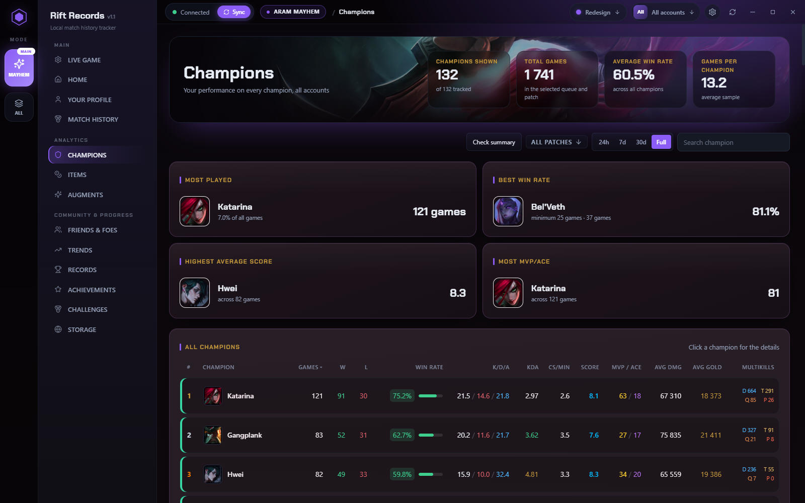
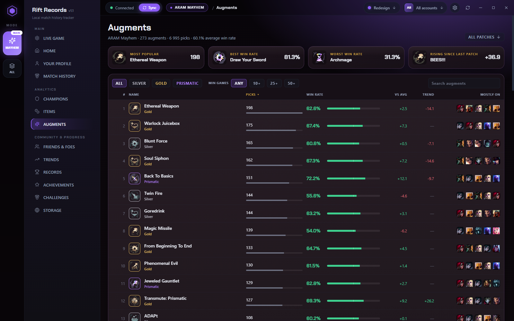
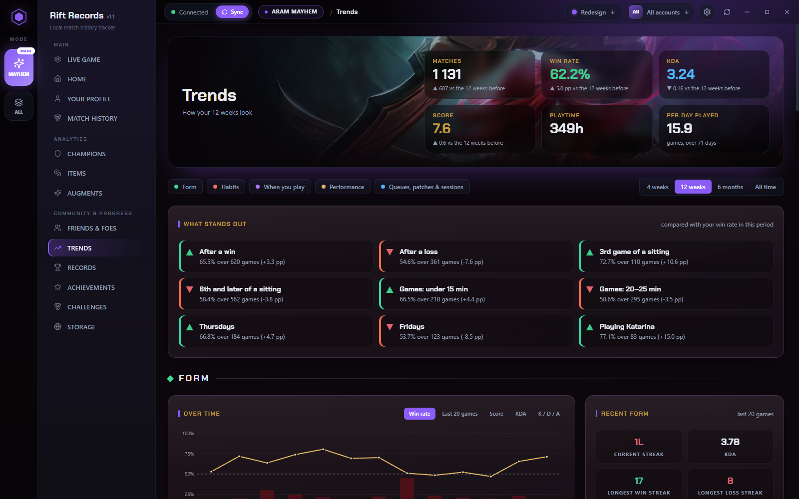

# Rift Records

A Windows desktop app that keeps your League of Legends match history on your own computer and turns it into dashboards: champions, items, augments, trends, records and live game data. ARAM Mayhem comes first, every other queue is tracked too.

**[Download the latest release](https://github.com/dxmegg/League-Tracker/releases/latest)** · [Changelog](CHANGELOG.md)


|                                                  |                                            |
| ------------------------------------------------ | ------------------------------------------ |
|  |  |
|        |      |

## Features

- **Automatic tracking**: detects the League client and stores games as you play, also from the system tray
- **Live Game**: scoreboard, game flow charts, events and peak stats while a match is running
- **Match history**: grouped by day and session, with a detailed page per match (items, runes, augments, per-player stats)
- **Champions, Items, Augments, Runes**: win rates, KDA, damage, gold, multikills and detailed breakdowns
- **Scoring**: separate systems for ARAM, Summoner's Rift and Arena, with MVP/ACE badges and a score breakdown on hover
- **Your Profile, Friends & Foes, Trends, Records**: habits, time-of-day patterns, who you play with and your best games
- **Achievements and Challenges**: tiers from Iron to Challenger, plus challenges read from the League client
- **Multiple accounts**: sync, show, hide or merge them
- **Your data stays yours**: local database, automatic backups, export and import
- **Themes**: Redesign (default), Legacy and Ancient

## Install

Windows 10/11 (64-bit). The app is portable: download `RiftRecords.exe` from [Releases](https://github.com/dxmegg/League-Tracker/releases) and run it.

### If the app does not start

The executable is not signed by a trusted certificate authority, so Windows may treat a fresh download with suspicion:

- If a blue "Windows protected your PC" screen appears, click **More info → Run anyway**.
- If nothing happens at all, right-click `RiftRecords.exe` → **Properties** → tick **Unblock** → OK, then run it again. Also check Windows Security → Protection history, in case antivirus quarantined it.
- If the app opens an error window, or `%APPDATA%\league-tracker\startup.log` exists, include that text in your report.

## Data and network

Match history is stored in `%APPDATA%\league-tracker`. There is no Rift Records account. The app talks to the League client, the Riot Games API (through a small proxy that holds the API key), Data Dragon and CommunityDragon (game art), OP.GG (player lookups) and GitHub (update checks).

## Development

```
npm install
npm run rebuild   # Rebuild native modules for Electron
npm run dev       # Start the application in development mode
npm run dist      # Build the Windows portable executable (dist/RiftRecords.exe)
```

## Legal

Rift Records was created under Riot Games' ["Legal Jibber Jabber" policy](https://www.riotgames.com/en/legal) using assets owned by Riot Games. Riot Games does not endorse or sponsor this project.

Rift Records isn't endorsed by Riot Games and doesn't reflect the views or opinions of Riot Games or anyone officially involved in producing or managing Riot Games properties. Riot Games and all associated properties are trademarks or registered trademarks of Riot Games, Inc.

## License

[MIT](LICENSE)
